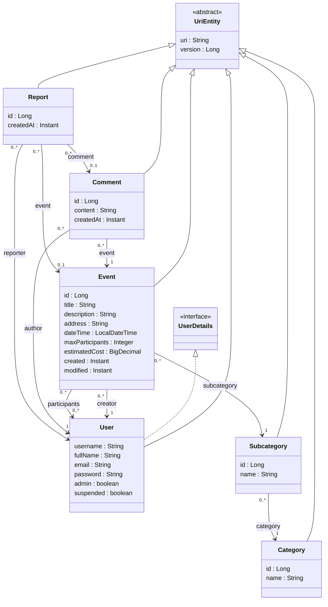

# VibeCheck API

Backend REST service for the VibeCheck platform, built with Spring Boot.

## Vision

**For** Erasmus students **who want to** easily find and organize local activities, **the VibeCheck project is an** event management and social discovery platform **that allows** users to explore, create, and join student events on an interactive map. **Unlike other** general social media platforms or scattered messaging groups, VibeCheck provides a single centralized hub specifically tailored for the international student community.

## Features per Stakeholder

| ERASMUS USER | ADMIN | ANONYMOUS |
| :--- | :--- | :--- |
| Register | Login | View public events |
| Login | Logout | View event locations |
| Logout | List flagged content | Search public events |
| Edit profile | Remove inappropriate event | Filter events by category |
| View profile | Suspend user | Redirect to Register |
| Create event | | |
| Edit event | | |
| Delete event | | |
| Join event (RSVP) | | |
| Leave event | | |
| Search and filter events | | |
| Post comments / event discussion | | |
| Report content / event | | |

## Entities Model

A `Report` targets exactly one event or one comment; deleting the target also deletes its reports.
